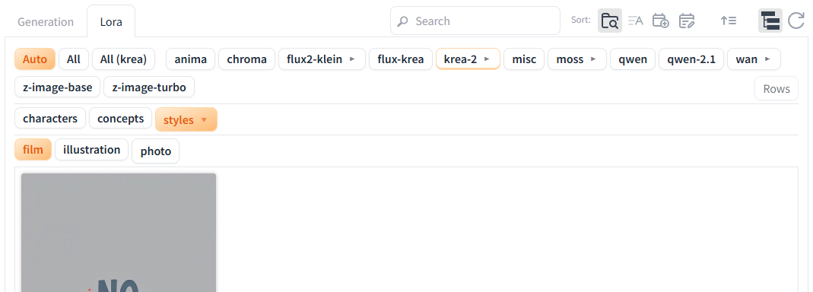
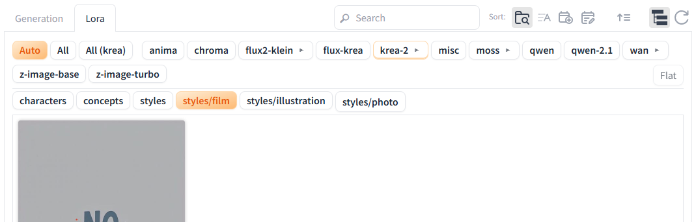

# Forge-Neo-Networks

A Forge Neo extension for the Checkpoints, Lora and Textual Inversion pages. It replaces the flat row of folder buttons with one that shows the first-level folders only, opens subfolders when you select a folder, and puts the folders of the current UI Preset first.



## The problem

Forge Neo lists every folder and every subfolder of a page as one flat row of buttons. With models for a dozen architectures, each with its own subfolders, that row fills the screen, and most of it has nothing to do with the model you are using.

Forge Neo cannot reliably tell which architecture a file is for, so it cannot hide the files that do not fit the selected UI Preset either.

## What the extension does

- **First-level folders only.** Row 1 shows the folders directly inside the model folder. The subfolders of a folder appear when you select it, and the subfolders of everything else stay out of sight.
- **Auto.** Sort your files into one folder per architecture, and "Auto" shows the folder that belongs to the current UI Preset. Change the preset and the bar follows.
- **A folder is a filter, not a search.** Selecting a folder leaves the search box empty, so you can search inside the selected folder.

Nothing in Forge Neo is modified. The bar is drawn inside the stock one, and if it cannot get its data the stock bar stays and works as before.

## Install

In Forge Neo: Extensions, Install from URL:

```text
https://github.com/aoleg/Forge-Neo-Networks
```

Then restart Forge Neo.

It needs Forge Neo, the `neo` branch of [sd-webui-forge-classic](https://github.com/Haoming02/sd-webui-forge-classic), and was written against commit `398279f` (2026-11-14). It works with "Extra Networks UI Style" set to "Dirs", which is the default. With "Tree" the stock tree is left as it is.

## Sort your files

Give every architecture its own first-level folder. Below that, use any subfolders you like.

```text
models/Lora/
    krea-2/
        styles/
            film/
            photo/
        characters/
    flux2-klein/
    moss/
    wan/
        high/
        low/
    a-file-outside-any-folder.safetensors
```

The same goes for `models/Stable-diffusion`, the embeddings folder, and every folder added with `--lora-dirs` or `--ckpt-dirs`. Folders of the same name in several of these places become one button.

## The bar

Row 1, from the left:

- **Auto**: the folders that belong to the current UI Preset, and the files outside any folder. The page opens on it.
- **All**: everything, as the stock "all" button.
- **All (preset)**: goes back to everything for the preset after you opened one of its folders.
- **The first-level folders.** A folder that belongs to the current preset is underlined. A small arrow marks a folder that has subfolders.
- **Rows / Flat**: how subfolders are laid out, see below.

Select a folder and the next row shows its subfolders. Select one of those and the row after it shows the next level. Selecting a folder shows everything in it, subfolders included. Click a selected folder again to close what is open below it.

Auto works the same way. With one folder for the preset, the next row shows that folder's subfolders at once. With several folders for the preset, the next row shows those folders. A folder that belongs to no preset still has its button in row 1, but is never part of Auto. When no folder belongs to the preset, Auto shows the files outside any folder and says so.

Files outside any folder show under Auto, All and All (preset), and not when you select a folder.

### Rows or Flat

"Rows" opens one row per folder level, which keeps the bar small. "Flat" puts every subfolder of the selected folder in one row as paths, which takes fewer clicks.



The button changes the setting "Folder bar: subfolders" and saves it, so the choice holds after a restart. Nothing is stored in the browser.

## Which folder belongs to which preset

A first-level folder belongs to a UI Preset when its name is the preset's name, or one of the preset's other names in the alias file. Upper and lower case do not matter: `moss`, `Moss` and `MOSS` all belong to `moss`. Only first-level folders are matched.

The presets of Forge Neo at the time of writing: `sd`, `xl`, `flux`, `klein`, `qwen`, `lumina`, `zit`, `wan`, `anima`, `ernie`, `pid`, `krea`, `qwen21`, `moss`. Presets added by other extensions are picked up as well.

Other folder names that are known out of the box:

| Preset | Folder names |
|---|---|
| `anima` | `anima-2.9b`, `anima-3.8b` |
| `fibo2` | `fibo-2.0` |
| `flux` | `flux-krea`, `chroma` |
| `h3image` | `minimax-h3`, `h3-image` |
| `ph3` | `p-h3-image`, `p-h3` |
| `klein` | `flux2`, `flux2-klein`, `klein-turbo` |
| `krea` | `krea-2` |
| `qwen21` | `qwen-2.1`, `qwen-image-2.1` |
| `wan` | anything that starts with `wan` |
| `zit` | `z-image-base`, `z-image-turbo` |

`fibo2`, `h3image` and `ph3` are presets that other extensions add. Their lines do nothing until such a preset exists.

Several folders may belong to one preset, and each keeps its own button. `z-image-base` and `z-image-turbo` both show under `zit`, and you can still select either one alone.

### A preset is an architecture, not a brand

Some names cover more than one architecture. "Krea" is the example to watch: Krea 2 is an architecture of its own, with the `krea` preset. The first Krea model, FLUX.1 Krea, is a Flux.1 checkpoint and belongs to the `flux` preset.

A folder named just `krea` is taken for Krea 2. Name the folder for first-generation Krea files `flux-krea`, and the one for Krea 2 `krea` or `krea-2`.

The same care applies to version numbers. `flux2` belongs to `klein`, while `flux3` is a different, newer architecture and belongs to nothing until a preset for it exists.

### Your own names

Create a text file named `aliases.txt` in the extension's folder, next to `aliases.default.txt`:

```text
# preset = folder, folder, ...
xl    = sdxl, pony, illustrious
klein = flux2*, klein-turbo
flux  =
```

- A line replaces the built-in line for that preset. A line with nothing after the `=` removes it.
- `*` stands for any run of characters and `?` for one character. A name must match the whole folder name.
- A preset's own name always matches and needs no line.
- A folder may be listed under more than one preset.
- A line that starts with `#` is a comment.

Press Refresh on an Extra Networks page to apply the file. Do not edit `aliases.default.txt`: an update of the extension replaces it.

## Hidden folders

A folder whose name starts with a dot is a hidden folder in Forge Neo. The extension follows the two Forge Neo settings for them, under Settings, Extra Networks.

With "Show the Extra Networks in hidden directories" set to "When searched", the default:

- Files in a hidden folder do not show under Auto, All, or a folder above it. Selecting `krea-2` leaves out `krea-2/.old`.
- Selecting the hidden folder itself shows its files.
- A search of four characters or more shows them wherever they are, as in stock Forge Neo.

With "Always" they are ordinary files, and with "Never" Forge Neo does not list them at all.

Turn off "Show Dir buttons of hidden directories" and hidden folders get no button at any level.

## Settings

Under Settings, Extra Networks:

- **Folder bar by first-level folder and UI Preset**: turns the extension off and on. Press Refresh on the page after changing it.
- **Folder bar: subfolders**: Rows or Flat. The button in the bar changes the same setting.
- **Folder bar: selection when the page opens**: Auto or All.

## Good to know

- Press Refresh after you add, move or rename folders and files, as you would without the extension.
- The selection is not kept across a reload of the page. Every page opens on Auto, or on All if you set it so.
- With `--freeze-settings` the Rows / Flat button still works, but the choice lasts only until the page is reloaded.

## License

MIT. See [LICENSE](LICENSE).
